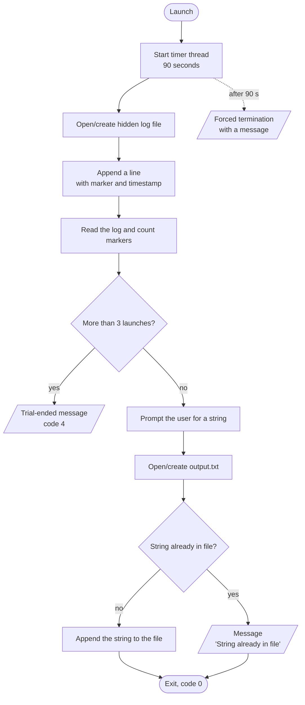

<div align="center">

**English** | [Русский](README.ru.md)

# 🧩 Programme (trial)

**An x64 assembly console application that saves entered strings to a file without duplicates and runs in trial mode**


-blueviolet)


</div>

---

## 📑 Contents

- [About](#-about)
- [Platform and technical requirements](#-platform-and-technical-requirements)
- [Building and linking (NASM + GoLink)](#-building-and-linking-nasm--golink)
- [Running](#-running)
- [How it works](#-how-it-works)
- [Trial version limitations](#-trial-version-limitations)
- [Exit codes](#-exit-codes)
- [Configuring paths](#-configuring-paths)
- [Known quirks](#-known-quirks)

---

## 📖 About

**Programme** is a small console application written entirely in assembly (NASM, Intel syntax) for 64-bit Windows. The code calls WinAPI functions directly, with no C runtime and no third-party libraries.

What the programme does:

1. Asks the user for a string.
2. Checks whether that string is already in `output.txt`.
3. If it is not, appends it to the end of the file; if it is, reports that and writes nothing.

The programme is distributed as a **trial version**: it can be launched at most 3 times on one device, and a single session lasts at most 90 seconds.

---

## 📂 Repository structure

```
Programme/
├── programme_1.asm   # the entire source code
└── README.md
```

---

## 💻 Platform and technical requirements

| Parameter | Value |
|---|---|
| **OS** | Windows 10 / 11, 64-bit |
| **Architecture** | x86-64 (`bits 64`) |
| **Calling convention** | Microsoft x64 ABI (`rcx`, `rdx`, `r8`, `r9` + shadow space on the stack) |
| **Application type** | Console (`/console`), a real console is required |
| **Assembler** | [NASM](https://www.nasm.us/) 2.15+ (`win64` format) |
| **Linker** | [GoLink](http://www.godevtool.com/) |
| **Libraries** | `kernel32.dll` |
| **Memory** | about 1.1 MB of static buffers in `.bss` |
| **Privileges** | Standard user; the folder for the trial-period log file must exist and be writable |

WinAPI functions used: `CreateFileA`, `ReadFile`, `WriteFile`, `GetFileSizeEx`, `SetFilePointerEx`, `GetLocalTime`, `CreateThread`, `Sleep`, `GetStdHandle`, `ReadConsoleW`, `WriteConsoleW`, `WriteConsoleA`, `GetLastError`, `CloseHandle`, `ExitProcess`.

> ℹ️ Input and output go through `ReadConsoleW` / `WriteConsoleW`, so the programme is meant to run in a regular console window. If input or output is redirected (`<`, `>`, `|`), these calls will fail.

---

## 🔧 Building and linking (NASM + GoLink)

Make sure `nasm.exe` and `golink.exe` are available from the command line (added to `PATH`) or sit in the current folder.

**1. Assemble**

```bat
nasm -f win64 programme_1.asm -o programme_1.obj
```

**2. Link**

```bat
golink /console /entry main programme_1.obj kernel32.dll
```

The result is `programme_1.exe`.

| GoLink switch | Meaning |
|---|---|
| `/console` | build a console application |
| `/entry main` | entry point is the `main` label |
| `kernel32.dll` | library from which all the WinAPI functions used are imported |

> 💡 Before building, change the paths defined in the code to suit your environment (see [Configuring paths](#-configuring-paths)).

---

## ▶️ Running

Run the programme from a command prompt or PowerShell:

```bat
programme_1.exe
```

After launch, a prompt appears (in Russian, "Введите строку :", meaning "Enter a string :"):

```
Введите строку :
```

Type some text and press `Enter`. There are two possible outcomes:

| Situation | Result |
|---|---|
| The string is not yet in `output.txt` | The string is appended to the end of the file and the programme exits with code `0` |
| The string is already in the file | The message `Строка уже есть в файле.` ("The string is already in the file.") is printed, nothing is written, exit code `0` |

`output.txt` is created in the process's **current working directory**. It is stored as UTF-16LE with a BOM, so it opens correctly in Notepad and most editors. Each string is written on its own line.

---

## ⚙️ How it works

### Overview



### Step 1. Timer thread

Right at startup, `CreateThread` spawns a background thread, `timeout_thread`. It sleeps for 90,000 ms (`Sleep`), then prints a message about the trial time being exceeded and terminates the whole process with `ExitProcess`. The thread handle is closed immediately (`CloseHandle`); this does not stop the thread itself.

### Step 2. Trial-period protection

1. A **hidden** journal file (`FILE_ATTRIBUTE_HIDDEN`) is created (or opened) with read and append-to-end access.
2. The current time is taken with `GetLocalTime`, and a line is built by hand (using the `PUT2`, `PUT3` and `PUT4YEAR` macros, which divide by 10/100/1000):

   ```
   [yyyy-mm-dd hh:mm:ss.mmm] [info] [thread: 11988] MSG_UPDATE_DXWIN PlayWindow Hwnd is: <64-character marker>
   ```

   The file is styled as a service log of an unrelated application.
3. The line is appended to the end of the file (`WriteFile`).
4. The whole file is read from the start (up to 64 KB) into a buffer, and the occurrences of the 64-character marker are counted with a byte-by-byte comparison in 1-byte steps. Each occurrence is one launch on this device.
5. If there are **more than three** occurrences (that is, this is the 4th launch or later), the programme prints the trial-ended message and exits with code `4`. Otherwise control passes to the main part.

### Step 3. String input

The prompt "Введите строку : " is printed with `WriteConsoleW` in UTF-16 (the text is defined as Unicode code points, so it does not depend on the encoding of the `.asm` file). The string is read with `ReadConsoleW` (up to 255 characters), and the trailing `CR LF` is stripped for searching.

### Step 4. Duplicate check

1. `output.txt` is opened with `OPEN_ALWAYS`. If the file was just created (`GetLastError` is not `ERROR_ALREADY_EXISTS` = 183), a UTF-16LE BOM (`FF FE`) is written at the start.
2. The file is read into a buffer of up to 1 MB, and the entered string is searched for in it as a substring, in 16-bit characters.
3. If a match is found: the message "Строка уже есть в файле." is printed and the programme exits with code `0`.

### Step 5. Writing

If there is no match, the string together with its line break (`CR LF`) is appended to the end of `output.txt` in UTF-16LE (`WriteFile`). The file is closed and the programme exits with code `0`.

---

## ⏳ Trial version limitations

| # | Limitation | Value | What happens when exceeded |
|---|---|---|---|
| 1 | **Number of launches** | at most **3** on one device | The 4th and subsequent launches are blocked. The message *"The programme has been launched on this device more than three times. You have reached the end of your trial period; please purchase the paid version."* is printed, and the exit code is `4` |
| 2 | **Session length** | at most **90 seconds** | The process is forcibly terminated with the message *"The programme ran for longer than the specified trial period. It was forcibly terminated. This attempt to use the programme was blocked."* |

To remove the limitations, purchase the full version.

> 🧪 **For developers:** the launch counter is stored in the hidden journal file (the path is set in `file_name`). To reset the counter while testing, remove the attribute and delete the file: `attrib -h "<path>"`, then `del "<path>"`.

---

## 🚦 Exit codes

| Code | Meaning |
|:---:|---|
| `0` | Success: the string was written, the string was already in the file, or the 90 seconds elapsed (after the message) |
| `1` | Failed to open the journal file; failed to get `stdout`; write error on `output.txt` |
| `2` | Write error on the journal file or a failure while processing it (size, seeking, reading); `WriteConsoleW` error |
| `3` | Failed to get `stdin` |
| `4` | Trial period ended (more than 3 launches), or `ReadConsoleW` error |
| `5` | Failed to create the thread or to open `output.txt` |
| `71` | `output.txt`: error getting the size, or the file is larger than 1 MB |
| `73` | `output.txt`: seek error (`SetFilePointerEx`) |
| `74` | `output.txt`: read error (`ReadFile`) |
| `75` | `output.txt`: fewer bytes were read than the file size |

> ℹ️ Some codes are used for several different errors, so a code only gives an approximate location of the failure.

---

## 🗂 Configuring paths

Some paths are hard-coded. Change them before building:

| Label | Purpose | Default value |
|---|---|---|
| `file_name` | hidden trial-period journal file | `C:\Users\User\Downloads\N0va Desсktop_2023-01-06.log` |
| `file_name_prg` | file with the entered strings | `output.txt` |
| `needle` and the end of `log_suffix` | 64-character launch marker (the two must match) | a fixed 64-character string |

> ⚠️ Replace the user name `User` in the path with your own; the folder must exist, otherwise the programme exits with code `1`.
>
> ⚠️ In the file name `Desсktop`, the letter "с" is Cyrillic. If you copy or change the path, make sure the keyboard layout does not change by accident.

---

## 🔍 Known quirks

- The duplicate search matches **substrings**, not whole lines: if the file contains `abcd`, entering `bc` counts as found.
- Empty input (just `Enter`) appends an empty line to the file.
- The trial journal is designed for a file of up to 64 KB; beyond that the programme exits with code `2`.
- Strings longer than 255 characters are truncated when read.

---

<div align="center">

Made in assembly with ❤️

</div>
