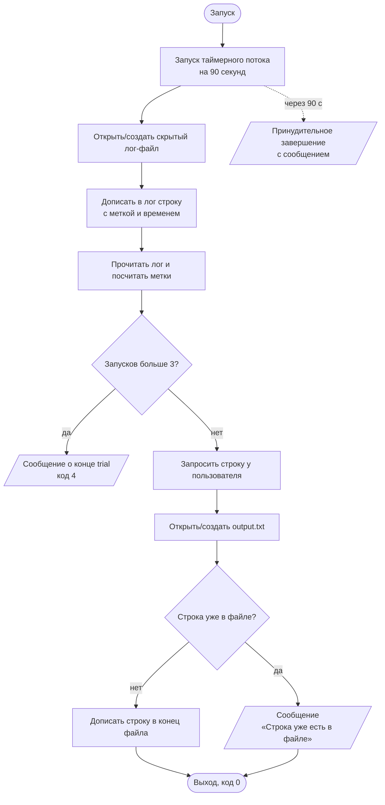

<div align="center">

[English](README.md) | **Русский**

# 🧩 Programme (trial)

**Консольная программа на ассемблере x64: сохраняет введённые строки в файл без дубликатов и работает в пробном режиме**


-blueviolet)


</div>

---

## 📑 Содержание

- [Описание](#-описание)
- [Платформа и технические требования](#-платформа-и-технические-требования)
- [Сборка и линковка (NASM + GoLink)](#-сборка-и-линковка-nasm--golink)
- [Запуск](#-запуск)
- [Как это работает](#-как-это-работает)
- [Ограничения пробной версии](#-ограничения-пробной-версии)
- [Коды завершения](#-коды-завершения)
- [Настройка путей](#-настройка-путей)
- [Известные особенности](#-известные-особенности)

---

## 📖 Описание

**Programme** — небольшая консольная программа, написанная целиком на ассемблере (NASM, синтаксис Intel) для 64-разрядной Windows. Код напрямую вызывает функции WinAPI, без C runtime и сторонних библиотек.

Что делает программа:

1. Запрашивает у пользователя строку.
2. Проверяет, нет ли такой строки в файле `output.txt`.
3. Если строки нет, дописывает её в конец файла; если есть, сообщает об этом и ничего не пишет.

Программа распространяется как **пробная версия (trial)**: её можно запустить не более 3 раз на одном устройстве, а один сеанс длится не более 90 секунд.

---

## 📂 Структура репозитория

```
Programme/
├── programme_1.asm   # весь исходный код
└── README.md
```

---

## 💻 Платформа и технические требования

| Параметр | Значение |
|---|---|
| **ОС** | Windows 10 / 11, 64-bit |
| **Архитектура** | x86-64 (`bits 64`) |
| **Соглашение о вызовах** | Microsoft x64 ABI (`rcx`, `rdx`, `r8`, `r9` + shadow space на стеке) |
| **Тип приложения** | Консольное (`/console`), нужна настоящая консоль |
| **Ассемблер** | [NASM](https://www.nasm.us/) 2.15+ (формат `win64`) |
| **Линковщик** | [GoLink](http://www.godevtool.com/) |
| **Библиотеки** | `kernel32.dll` |
| **Память** | около 1,1 МБ статических буферов в `.bss` |
| **Права** | Обычный пользователь; каталог с лог-файлом пробного периода должен существовать и быть доступным для записи |

Используемые функции WinAPI: `CreateFileA`, `ReadFile`, `WriteFile`, `GetFileSizeEx`, `SetFilePointerEx`, `GetLocalTime`, `CreateThread`, `Sleep`, `GetStdHandle`, `ReadConsoleW`, `WriteConsoleW`, `WriteConsoleA`, `GetLastError`, `CloseHandle`, `ExitProcess`.

> ℹ️ Ввод и вывод идут через `ReadConsoleW` / `WriteConsoleW`, поэтому программа рассчитана на запуск в обычном окне консоли. При перенаправлении ввода или вывода (`<`, `>`, `|`) эти вызовы завершатся ошибкой.

---

## 🔧 Сборка и линковка (NASM + GoLink)

Убедитесь, что `nasm.exe` и `golink.exe` доступны из командной строки (добавлены в `PATH`) или лежат в текущей папке.

**1. Ассемблирование**

```bat
nasm -f win64 programme_1.asm -o programme_1.obj
```

**2. Линковка**

```bat
golink /console /entry main programme_1.obj kernel32.dll
```

На выходе получится `programme_1.exe`.

| Ключ GoLink | Значение |
|---|---|
| `/console` | собрать консольное приложение |
| `/entry main` | точка входа — метка `main` |
| `kernel32.dll` | библиотека, из которой импортируются все используемые функции WinAPI |

> 💡 Перед сборкой измените пути, заданные в коде, под своё окружение (см. [Настройка путей](#-настройка-путей)).

---

## ▶️ Запуск

Запустите программу из командной строки или PowerShell:

```bat
programme_1.exe
```

После запуска появится приглашение (на русском языке):

```
Введите строку :
```

Введите текст и нажмите `Enter`. Дальше возможны два исхода:

| Ситуация | Результат |
|---|---|
| Такой строки в `output.txt` ещё нет | Строка дописывается в конец файла, программа завершается с кодом `0` |
| Строка уже есть в файле | Выводится сообщение `Строка уже есть в файле.`, запись не выполняется, код `0` |

Файл `output.txt` создаётся в **текущей рабочей папке** процесса. Он хранится в UTF-16LE с BOM, поэтому корректно открывается в Блокноте и большинстве редакторов. Каждая строка записывается с новой строки.

---

## ⚙️ Как это работает

### Общая схема



### Шаг 1. Таймерный поток

Сразу при старте через `CreateThread` создаётся фоновый поток `timeout_thread`. Он засыпает на 90 000 мс (`Sleep`), затем выводит сообщение о превышении пробного времени и завершает весь процесс через `ExitProcess`. Дескриптор потока сразу закрывается (`CloseHandle`), это не останавливает сам поток.

### Шаг 2. Защита пробного периода

1. Создаётся (или открывается) **скрытый** файл-журнал (`FILE_ATTRIBUTE_HIDDEN`) с правами чтения и дозаписи в конец.
2. Через `GetLocalTime` берётся текущее время, и вручную (с помощью макросов `PUT2`, `PUT3`, `PUT4YEAR`, деление на 10/100/1000) формируется строка:

   ```
   [гггг-мм-дд чч:мм:сс.мсс] [info] [thread: 11988] MSG_UPDATE_DXWIN PlayWindow Hwnd is: <64-символьная метка>
   ```

   Файл оформлен как служебный лог постороннего приложения.
3. Строка дописывается в конец файла (`WriteFile`).
4. Файл читается с начала целиком (до 64 КБ) в буфер, и побайтовым сравнением с шагом 1 подсчитывается число вхождений 64-символьной метки. Каждое вхождение — один запуск на этом устройстве.
5. Если вхождений **больше трёх** (то есть это 4-й запуск или позже), программа выводит сообщение о конце пробного периода и завершается с кодом `4`. Иначе управление передаётся основной части.

### Шаг 3. Ввод строки

Приглашение «Введите строку : » выводится через `WriteConsoleW` в UTF-16 (текст задан кодами символов Unicode, поэтому не зависит от кодировки `.asm`-файла). Строка читается через `ReadConsoleW` (до 255 символов), после чего завершающие `CR LF` отрезаются для поиска.

### Шаг 4. Проверка на дубликат

1. `output.txt` открывается с режимом `OPEN_ALWAYS`. Если файл создан только что (`GetLastError` не равен `ERROR_ALREADY_EXISTS` = 183), в начало записывается BOM UTF-16LE (`FF FE`).
2. Файл читается в буфер до 1 МБ, и введённая строка ищется в нём подстрокой по 16-битным символам.
3. Совпадение найдено: сообщение «Строка уже есть в файле.», выход с кодом `0`.

### Шаг 5. Запись

Если совпадения нет, строка вместе с переводом строки (`CR LF`) дописывается в конец `output.txt` в кодировке UTF-16LE (`WriteFile`). Файл закрывается, программа завершается с кодом `0`.

---

## ⏳ Ограничения пробной версии

| # | Ограничение | Значение | Что происходит при превышении |
|---|---|---|---|
| 1 | **Количество запусков** | не более **3** на одном устройстве | 4-й и последующие запуски блокируются, выводится сообщение *«The programme has been launched on this device more than three times. You have reached the end of your trial period; please purchase the paid version.»*, код завершения `4` |
| 2 | **Длительность одного сеанса** | не более **90 секунд** | Процесс принудительно завершается с сообщением *«The programme ran for longer than the specified trial period. It was forcibly terminated. This attempt to use the programme was blocked.»* |

Чтобы снять ограничения, необходимо приобрести полную версию.

> 🧪 **Для разработчика:** счётчик запусков хранится в скрытом файле-журнале (путь задан в `file_name`). Чтобы сбросить счётчик при тестировании, снимите атрибут и удалите файл: `attrib -h "<путь>"`, затем `del "<путь>"`.

---

## 🚦 Коды завершения

| Код | Значение |
|:---:|---|
| `0` | Успех: строка записана, строка уже была в файле, либо истекли 90 секунд (после сообщения) |
| `1` | Не удалось открыть файл-журнал; не удалось получить `stdout`; ошибка записи в `output.txt` |
| `2` | Ошибка записи в файл-журнал или его обработки (размер, позиционирование, чтение); ошибка `WriteConsoleW` |
| `3` | Не удалось получить `stdin` |
| `4` | Пробный период закончен (более 3 запусков) либо ошибка `ReadConsoleW` |
| `5` | Не удалось создать поток либо открыть `output.txt` |
| `71` | `output.txt`: ошибка получения размера или файл больше 1 МБ |
| `73` | `output.txt`: ошибка позиционирования (`SetFilePointerEx`) |
| `74` | `output.txt`: ошибка чтения (`ReadFile`) |
| `75` | `output.txt`: прочитано меньше байт, чем размер файла |

> ℹ️ Некоторые коды используются для нескольких разных ошибок, поэтому по коду можно определить лишь примерное место сбоя.

---

## 🗂 Настройка путей

Часть путей задана в коде жёстко. Измените их перед сборкой:

| Метка | Назначение | Значение по умолчанию |
|---|---|---|
| `file_name` | скрытый файл-журнал пробного периода | `C:\Users\User\Downloads\N0va Desсktop_2023-01-06.log` |
| `file_name_prg` | файл с введёнными строками | `output.txt` |
| `needle` и конец `log_suffix` | 64-символьная метка запуска (должны совпадать) | фиксированная строка из 64 символов |

> ⚠️ Замените имя пользователя `User` в пути на своё; каталог должен существовать, иначе программа завершится с кодом `1`.
>
> ⚠️ В имени файла `Desсktop` буква «с» кириллическая. Если вы копируете или меняете путь, следите за тем, чтобы раскладка не изменилась случайно.

---

## 🔍 Известные особенности

- Поиск дубликатов выполняется **по подстроке**, а не по целой строке: если в файле есть `abcd`, то ввод `bc` будет считаться найденным.
- Пустой ввод (просто `Enter`) в файл добавляет пустую строку.
- Лог пробного периода рассчитан на файл до 64 КБ; при превышении программа завершается с кодом `2`.
- Строки длиннее 255 символов обрезаются при чтении.

---

<div align="center">

Сделано на ассемблере с ❤️

</div>
